  

### `$ ls ~/projects`

| project | what it is |
| --- | --- |
| [**evrcad-insurance**](https://github.com/dmoney25632/evrcad-insurance) | CMS-compliant ops platform for Medicare insurance agencies: agent performance, clients, book of business |
| [**quantum**](https://github.com/dmoney25632/quantum) | Zero-dependency quantum computing playground: simulator + classic algorithms |
| [**bom-zelda-multiplayer**](https://github.com/dmoney25632/bom-zelda-multiplayer) | Browser multiplayer top-down adventure, NES-inspired, controller support (Vercel + Supabase) |
| [**peyton**](https://github.com/dmoney25632/peyton) | Personal website |
| [**sellme**](https://github.com/dmoney25632/sellme) | TypeScript side project |

### `$ cat stack.txt`

  

### `$ git log --graph`

<picture>
  <source media="(prefers-color-scheme: dark)" srcset="https://raw.githubusercontent.com/dmoney25632/dmoney25632/output/snake-dark.svg"/>
  <source media="(prefers-color-scheme: light)" srcset="https://raw.githubusercontent.com/dmoney25632/dmoney25632/output/snake.svg"/>
  
</picture>

card + snake regenerate daily via GitHub Actions
